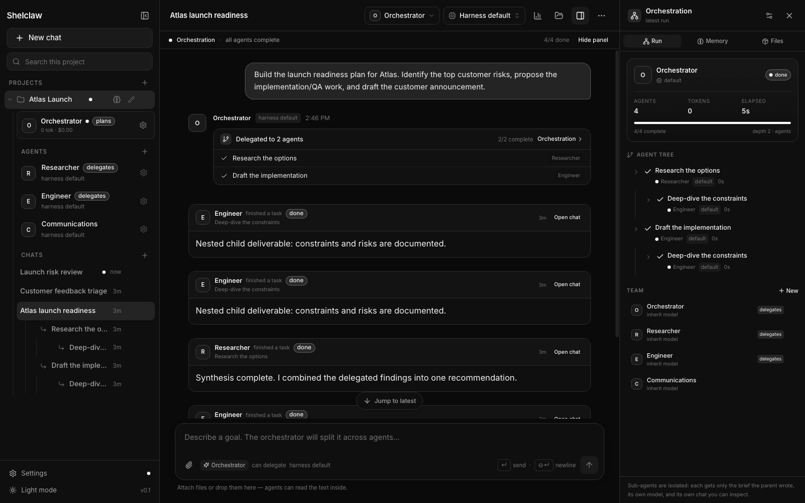
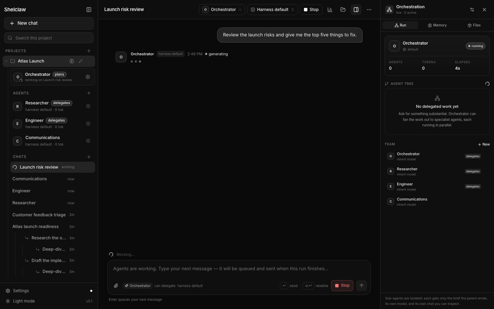
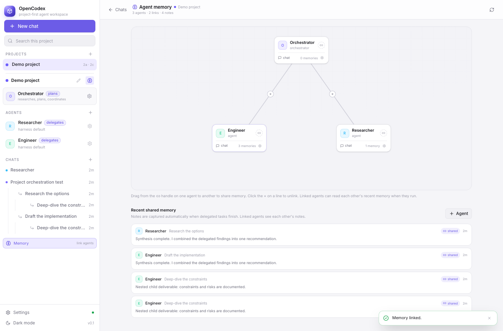
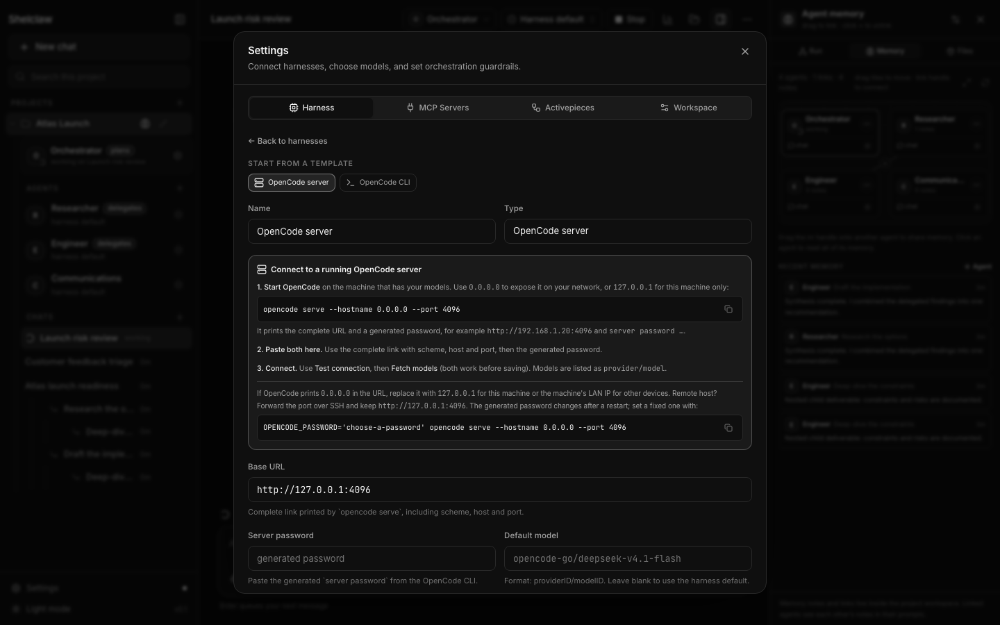

# OpenCodex

A local-first, project-first workspace for orchestrating **local agent harnesses**. Each project owns its own Orchestrator, agents and chats. Agents run in parallel, report their finished work back to the conversation, and can share memory through a graph in the right-hand inspector.



## What it does

- **Projects are the root** — agents and chats live inside a project, not in separate global lists.
- **One Orchestrator per project** — researches the request, builds a plan, and coordinates execution. No default specialist agents are installed; you create the team.
- **Agents chat directly** — click an agent in the sidebar to open its own chat. The gear icon opens its prompt and model settings.
- **Agent reports** — whenever a delegated task finishes, the agent's name and result appear as a message in the originating chat, even while you are elsewhere.
- **Live working indicators** — the Orchestrator and agents pulse with a working state and the task they are running.
- **File attachments** — attach or drag files into any Orchestrator or agent chat. Text files are read into the prompt; every file is downloadable from the message.
- **Per-project workspace folders** — every project requires a workspace folder for its uploaded files, memory notes and embeddings. No implicit default is created.
- **Message queue per chat** — keep sending while an agent works. Messages are stored server-side and sent in order when the current run finishes. Different chats still run in parallel.
- **Shared memory in the inspector** — open the Memory tab on the right, drag between agents to link their memory, and review recent notes without leaving the chat.
- **Delete chats** — remove a conversation (and its sub-agent chats and uploads) from the sidebar or the chat header.
- **Local harnesses only** — OpenCode server/CLI, Claude Code CLI, Pi CLI, or any custom local command. No cloud LLM endpoints to configure.
- **Archive older chats** — hide finished conversations and their sub-agent trees without deleting them.
- **Runs anywhere Node runs** — Node 24 + built-in SQLite, no native addons. Docker included for Mac, PC and Raspberry Pi.



## Quick start

Requirements: **Node 24+** and at least one local harness (`opencode`, `claude`, `pi`, or a custom command).

```bash
git clone <your-github-repo-url> opencodex
cd opencodex
npm ci
npm run build
npm start
# http://localhost:8787
```

For development with hot reload:

```bash
npm install
npm run dev
# web: http://localhost:5173
# api: http://localhost:8787
```

The SQLite database lives in `./data/opencodex.db` by default. Set `DATA_DIR` to move it. Harness connections, projects, agents, chats, reports and memory all persist across restarts.

1. Click **New project** and give it a name, brief and **required workspace folder**.
2. Open **Settings → Connect Harness** and connect a harness.
3. Create agents from the project sidebar.
4. Click an agent to chat with it, or start a **New chat** with the project Orchestrator.
5. Attach files with the paperclip, drag-and-drop, or paste; then send.
6. Click the gear on any agent (including the Orchestrator) to edit its system prompt and model. Use the **Memory** tab in the right inspector to link agents.

### Demo without a real agent harness

A deterministic local harness ships in `scripts/mock-harness.mjs`:

1. Add a **Custom local harness**.
2. Command: `/absolute/path/to/opencodex/scripts/mock-harness.mjs`
3. Arguments: none
4. Prompt transport: **As the final argument**
5. **Test connection**, save.
6. Create a project with two agents named **Researcher** and **Engineer**, then chat with the Orchestrator.

It delegates, nests one more agent, writes agent reports and memory notes, and needs no model or network connection.

## Projects

A project is the top-level container. It owns:

- its **Orchestrator** (created automatically, not deletable)
- **agents** created by you
- **chats**, including direct agent chats and sub-agent chats
- the **memory graph** and memory notes
- a **project brief** injected into the root agent's prompt
- a **workspace folder** for uploaded files, memory notes and embeddings

Switch projects from the list at the top of the sidebar. Deleting a project deletes its agents and chats; the confirmation dialog warns you. Workspace folders are never deleted automatically — they belong to you.

### Workspace folder

A workspace folder is **required** when creating a project and there is no implicit default. The server must be able to create and write to the path. You can change it later in project settings (the pencil icon) until files have been uploaded.

```
<workspace>/
  chats/<chatId>/uploads/        attachments for that chat
  agents/                        per-agent artifacts
  memory/<agentId>/notes.jsonl   memory notes for one agent
  memory/shared/links.json       memory-link graph
  embeddings/<agentId>/memory-index.jsonl
```

Uploads are capped at 25 MB each, up to 8 files per message. The folder must be writable by the server process. A folder cannot be moved after a project has uploads; create a new project instead.

## File attachments

Every Orchestrator and agent chat accepts files:

- paperclip button, drag-and-drop, or paste
- pending attachments are stored immediately in the chat's workspace `uploads` folder and shown as chips
- send attaches them to the message, where they can be downloaded again
- text-like files (code, markdown, JSON, CSV, logs and similar) are injected into the prompt with a size budget; binaries appear as a file manifest with their workspace path
- deleting a chat or file removes the database row and the workspace copy

## Message queue

Each chat accepts messages while a run is active. Instead of rejecting the message, OpenCodex stores it in a per-chat queue:

- queued messages appear as dashed bubbles in the conversation and can be removed individually
- when the current run finishes, the next queued message starts automatically, in order
- **Stop** cancels the active run and clears that chat's queue
- the queue is persisted in SQLite and resumes after a server restart
- separate chats are independent, so they can work in parallel

## Deleting chats

Hover a chat in the sidebar and click the trash icon, or use the menu in the chat header. Deletion removes the chat, its sub-agent chats, messages, tasks and uploaded files. You must confirm first.

## Orchestrator and agents

Every project starts with one Orchestrator and **zero default specialist agents**.

The Orchestrator prompt emphasises:

- researching the problem and gathering context itself
- planning goals, constraints, risks and verification
- delegating substantial, independent execution work when specialist agents exist
- synthesising and verifying the results rather than dumping raw output

Create agents with **+** in the Agents section. Each agent has its own name, prompt, colour, harness, model and delegation limits. The settings gear opens the editor.

Clicking an agent opens a persistent **direct chat** with that agent. A direct chat still supports delegation and reports; if you archive or delete the direct chat, clicking the agent creates a fresh one.

## Agent reports

When a delegated task completes, OpenCodex inserts an **agent message** into the originating root chat (normally the project Orchestrator chat):

- the agent's name, colour and model
- the task title and status
- the deliverable (truncated in the report; the sub-agent chat keeps the full result)
- a link to open the sub-agent chat

Reports are persisted, so they appear even if you were chatting somewhere else when the task finished. A toast notifies you when the report lands in a chat you are not viewing.


## Memory

Memory lives in the **right-hand inspector**. Open it with the brain icon next to a project (or the Inspector tab in the chat header) and choose **Memory**. Each agent is a node; drag from the dashed link handle on one agent to another to create a memory link. Click the **×** on a line to unlink.

- Recent results are recorded automatically as memory notes when delegated tasks finish.
- Linked agents read each other's recent memory on their next run.
- Memory is injected into prompts as "Shared memory", clearly separated from instructions.
- Orchestrator memory shows up in the same graph as specialist memory.
- Notes and links are mirrored into the project workspace (`memory/` and `embeddings/`).



## Harnesses

| Harness | How it runs |
| --- | --- |
| **OpenCode server** | Connects to a running `opencode serve` over HTTP using its URL and password. Models use `providerID/modelID`. |
| **OpenCode CLI** | Runs `opencode run` locally with your OpenCode config and credentials. |
| **Claude Code CLI** | Runs `claude -p` locally with your Claude Code login. |
| **Pi CLI** | Runs `pi -p` locally in non-interactive text mode. |
| **Custom local harness** | Runs any local executable that accepts a prompt argument or stdin and writes text to stdout. |

Direct model APIs (OpenAI, Azure OpenAI, Anthropic, Ollama, LM Studio, etc.) are intentionally **not** supported. OpenCodex only orchestrates local agent processes.

### Connecting to an OpenCode server

OpenCode v2 exposes an HTTP API. This integration talks to it server-side; it requires a v2 build (`opencode serve`, tested with v2.1.4).



Start it on the machine that has your models and credentials:

```bash
opencode serve --hostname 0.0.0.0 --port 4096
```

It prints two lines:

```
server listening on http://0.0.0.0:4096
server password <generated-password>
```

Use those in **Settings → Connect Harness → Add harness → OpenCode server**:

1. **Base URL** — the complete link, including scheme, host and port. Examples:
   - same machine: `http://127.0.0.1:4096`
   - LAN: `http://192.168.1.20:4096`
   - SSH tunnel: `ssh -L 4096:127.0.0.1:4096 user@host`, then use `http://127.0.0.1:4096`
2. **Server password** — paste the generated `server password …` value.
3. **Test connection** → **Fetch models** → save.
4. Optional: choose the **OpenCode agent** (`build`, `plan`, `general`, or a custom id) and a working directory.

`0.0.0.0` is a bind address, not a connect address. OpenCodex rewrites it to `127.0.0.1`; use the machine's LAN IP when connecting from another device.

The generated password changes whenever the server restarts. For a stable setup:

```bash
OPENCODE_PASSWORD='choose-a-strong-password' opencode serve --hostname 0.0.0.0 --port 4096
```

OpenCodex authenticates over HTTP Basic auth (`opencode:<password>`) entirely server-side. Do not expose the OpenCode port to the public internet without TLS and network controls.

Each run creates an OpenCode session titled `OpenCodex · …`. OpenCode's own tools run inside that session.

### Pi and custom local harnesses

The **Pi CLI** template runs:

```bash
pi -p --mode text -- <prompt>
```

It uses Pi's configured model unless you set a default model. The **Custom local harness** template exposes:

- **Command** — executable on the server host (e.g. `my-agent`)
- **Arguments** — one per line, placed before the prompt
- **Prompt transport** — final argument, or stdin
- **Model flag** — optional, e.g. `--model`; the selected model is appended
- **Working directory** — optional
- **Default model** — leave blank to use the harness default

Harness output is streamed into the chat. If a command writes JSON, wrap it in a script that prints plain text.

### Model selection order

For an agent run:

1. Explicit provider/model on the message (sent by the header)
2. The chat's saved harness/model
3. The agent's harness/model
4. Workspace default harness/model
5. First configured harness

For a delegated task:

1. `provider` / `model` fields in the task
2. The chosen agent's harness/model
3. The parent agent's model when the harness is the same
4. The harness default

Leaving the model empty uses the harness's own default. A **Harness default** entry is available in the chat header model picker.

### Advanced harness config

Settings → Connect Harness → Edit → Advanced configuration accepts JSON.

OpenCode server:

```jsonc
{
  "agent": "build",
  "workdir": "/path/to/project",
  "variant": "default",
  "autoApprove": true,
  "permissions": [
    { "action": "*", "resource": "*", "effect": "allow" }
  ]
}
```

`autoApprove` grants broad tool access. Enable it only for trusted workspaces.

OpenCode CLI / Claude Code CLI:

```jsonc
{
  "command": "opencode",
  "workdir": "/path/to/project",
  "args": ["--agent", "build"],
  "env": { "SOME_VAR": "value" }
}
```

Custom local harness / Pi:

```jsonc
{
  "command": "pi",
  "args": ["-p", "--mode", "text", "--"],
  "promptMode": "arg",               // "arg" or "stdin"
  "modelFlag": "--model",
  "workdir": "/path/to/project",
  "env": {}
}
```

## How orchestration works

Every agent run gets a delegation protocol when it can delegate and the project has specialist agents:

```xml
<opencodex_tool>
{"name":"spawn_agents","arguments":{"tasks":[
  {"title":"Research the options","instructions":"Complete, self-contained brief…","agent":"Researcher","model":"optional-model"}
]}}
</opencodex_tool>
```

OpenCodex:

1. Streams the harness output while hiding the protocol block from the UI.
2. Parses the block into tasks.
3. Creates an isolated child chat for each task.
4. Runs children in parallel, or nested when a child delegates too.
5. Returns each deliverable to the parent as a tool result.
6. Writes an agent report and a memory note.
7. Asks the parent to synthesise.

Children see only their brief, their own agent prompt, and their shared memory. The tree, status and outputs stay inspectable in the right-hand panel.

Guardrails: workspace **max depth** (0 disables delegation), **parallel agents** per round (1–8), **max agents per run**, **max steps** per agent, and per-agent `canSpawn` / `maxDepth` / `maxSteps`.

## Stack

- **Server:** Node 24, TypeScript, Fastify, `node:sqlite` (no native dependencies), SSE.
- **Web:** React 19, Vite, Tailwind CSS v4, Zustand, react-markdown + highlight.js.
- **Storage:** one SQLite file in `DATA_DIR`; WAL mode.
- **Streaming:** server-sent events (`/api/events`).

```
server/src
  providers/     OpenCode server, OpenCode CLI, Claude Code, Pi/generic local harness
  orchestrator/  delegation protocol, reports, recursive run engine, cancellation
  routes.ts      REST API + SSE
  store.ts       typed SQLite access (projects, agents, chats, memory)
web/src
  components/    sidebar, chat, composer, inspector, memory graph, settings, editors
  store.ts       client state + SSE reducer
```

## Data and persistence

Everything lives in one SQLite database (WAL mode):

- harness connections and their credentials/passwords
- projects, agents, chats, messages, runs/tasks
- uploaded-file metadata, archive state, agent reports and memory links/notes
- workspace settings

Bare metal: `DATA_DIR/opencodex.db` (default `./data/opencodex.db`). Docker: the `opencodex-data` volume mounted at `/data`. Restarting the app or container does **not** clear it.

Project workspaces are chosen per project and required at creation. The database is the source of truth; workspace files are the durable copies of uploads, memory notes and embedding indexes. Project deletion never deletes the workspace folder.

The database file is not encrypted; protect it like any credential store. Use the backup commands in the Docker section or copy the SQLite file (plus `-wal`/`-shm` while running, or stop the app first). Back up custom workspace folders separately.

## Deployment

### Docker (recommended)

```bash
cp .env.example .env        # optional: set APP_TOKEN
docker compose up -d --build
# http://localhost:8787
```

The app and its SQLite database are stored in the **`opencodex-data` named volume**. Harness connections, projects, agents, chats, uploads and memory survive container rebuilds and restarts.

- `docker compose down` keeps the data volume.
- `docker compose down -v` deletes the database and all app data.
- Change the host port with `HOST_PORT=9000 docker compose up -d`.
- Inspect logs with `docker compose logs -f`.
- Custom project workspace folders must be mounted into the container and use container-visible paths (for example, mount a host folder at `/workspaces` and enter `/workspaces/my-project`).

Back up or restore the database:

```bash
# backup
docker run --rm -v opencodex-data:/data -v "$PWD":/backup alpine \
  tar czf /backup/opencodex-data.tgz -C /data .

# restore (stops nothing; restart the container afterwards)
docker run --rm -v opencodex-data:/data -v "$PWD":/backup alpine \
  tar xzf /backup/opencodex-data.tgz -C /data
docker compose restart
```

If your Docker build runs behind a TLS-inspecting proxy and npm cannot verify certificates, copy your npm config into the project as a temporary build secret. The default secret file is `.npmrc.docker`:

```bash
cp ~/.npmrc .npmrc.local
NPMRC_PATH=.npmrc.local docker compose up -d --build
rm .npmrc.local        # after the build; it is gitignored
```

Or build directly:

```bash
cp ~/.npmrc .npmrc.local
docker build --secret id=npmrc,src=.npmrc.local -t opencodex .
rm .npmrc.local
```

Multi-arch images build natively on Apple Silicon, x86 PCs and **64-bit** Raspberry Pi OS (`arm64`).

**Harness binaries:** the image includes Node and the demo harness in `/app/scripts`, but not `opencode`, `claude` or `pi`. Either install them in a derived image, or run the harnesses on the host. For OpenCode server on the host, use `http://host.docker.internal:4096` on Docker Desktop or the host's LAN IP on Linux. For CLI harnesses, install the binaries inside the container and mount their credential/config directories.

### Plain Node

```bash
git clone <your-github-repo-url> opencodex
cd opencodex
npm ci
npm run build
HOST=0.0.0.0 PORT=8787 DATA_DIR=/var/lib/opencodex npm start
```

Put it behind Caddy/nginx for HTTPS and set `APP_TOKEN` when exposing it beyond localhost. Example systemd unit:

```ini
[Unit]
Description=OpenCodex
After=network-online.target

[Service]
WorkingDirectory=/opt/opencodex
Environment=HOST=127.0.0.1 PORT=8787 DATA_DIR=/var/lib/opencodex
ExecStart=/usr/bin/node server/dist/index.js
Restart=always
User=opencodex

[Install]
WantedBy=multi-user.target
```

### Environment

| Variable | Default | Purpose |
| --- | --- | --- |
| `PORT` | `8787` | HTTP port |
| `HOST` | `127.0.0.1` | Bind address. Use `0.0.0.0` in containers/LAN. |
| `DATA_DIR` | `./data` | SQLite location |
| `APP_TOKEN` | empty | Optional bearer token gate for every API/SSE request |
| `OPENCODE_BIN` | `opencode` | Default OpenCode executable |
| `CLAUDE_BIN` | `claude` | Default Claude Code executable |
| `LOG_LEVEL` | `warn` | Fastify log level |
| `HOST_PORT` | `8787` | Docker Compose host port |
| `NPMRC_PATH` | `.npmrc.docker` | npm config file used as a Docker build secret |

Harness credentials stay on the server. The SQLite file is **not encrypted** — protect it like any credential store, and back it up when upgrading.

## API overview

All endpoints are under `/api`; JSON in/out, SSE at `/api/events`.

- `GET /api/health`, `GET /api/bootstrap`
- `POST/PATCH/DELETE /api/providers`, `POST /api/providers/:id/test`, `.../models`, `POST /api/providers/probe`, `.../discover`
- `POST/PATCH/DELETE /api/projects`, `GET /api/projects/:id/memory`, `POST /api/projects/:id/links`
- `DELETE /api/links/:id`
- `POST/PATCH/DELETE /api/agents`, `POST /api/agents/:id/chat`
- `POST/GET/PATCH/DELETE /api/chats`, `POST /api/chats/:id/messages`
  - `PATCH /api/chats/:id` with `{"archived": true}` archives the chat and its descendants; `false` restores them.
- `GET/POST /api/chats/:id/files` (multipart upload, max 25 MB × 8), `GET/DELETE /api/files/:id`
- `DELETE /api/queue/:id` removes a queued message; `POST /api/chats/:id/messages` returns `{queued: true}` when the chat is busy
- `POST /api/chats/:id/cancel`, `POST /api/runs/:id/cancel`
- `PATCH /api/settings`

SSE event types include `message.created`, `message.delta`, `message.completed`, `task.created`, `task.updated`, `run.created`, `run.updated`, `chat.updated`, `chats.changed`, `agents.changed`, `memory.changed`, `toast`.

## Scripts

```bash
npm run dev        # API + Vite dev server
npm run build      # build web, then server
npm start          # serve both from one process
npm run typecheck  # server + web
```

The demo harness is `scripts/mock-harness.mjs`.

## Current limits

- **Local harnesses only** by design. OpenAI/Azure/Anthropic/Ollama/model endpoints are not exposed.
- Each harness binary must be installed and executable on the server host (or inside the container).
- A harness must follow the delegation protocol to delegate. If it refuses, it answers directly.
- Agent reports and memory notes are automatic; they are not editable yet.
- OpenCode server sessions are kept in OpenCode for inspection.
- A run is held in memory for cancellation; after a server restart, in-flight runs are marked interrupted.
- Single-user, local-first: no accounts. Use `APP_TOKEN` if exposing the app.

## License

MIT
