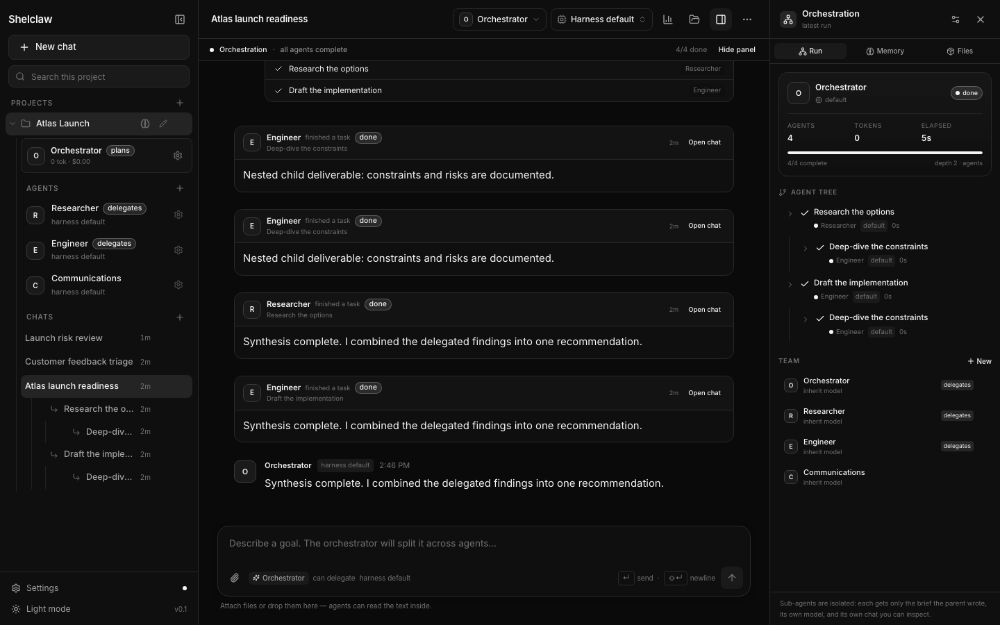

# Shelclaw

A local-first, project-first workspace for orchestrating **local agent harnesses**. Each project owns its own Orchestrator, agents and chats. Agents run in parallel, report their finished work back to the conversation, and can share memory through a graph in the right-hand inspector.


## What it does

- **Projects are the root** — agents and chats live inside a project, not in separate global lists.
- **One Orchestrator per project** — researches the request, builds a plan, and coordinates execution. No default specialist agents are installed; you create the team.
- **Agents chat directly** — click an agent in the sidebar to open its own chat. The gear icon opens its prompt and model settings.
- **Agent reports** — whenever a delegated task finishes, the agent's name and result appear as a message in the originating chat, even while you are elsewhere.
- **Live working indicators** — the Orchestrator and agents pulse with a working state and the task they are running.
- **File attachments** — attach or drag files into any Orchestrator or agent chat. Text files are read into the prompt; every file is downloadable from the message.
- **Side file previews** — click any attachment or workspace file to open a side panel. PDFs use the browser viewer, images render inline, XLSX/CSV sheets show as tables, DOCX shows formatted content, and text/code is displayed directly. A project file browser lists files agents created in the workspace.
- **Per-project workspace folders** — every project requires a workspace folder for its uploaded files, memory notes and embeddings. No implicit default is created.
- **Message queue per chat** — keep sending while an agent works. Messages are stored server-side and sent in order when the current run finishes. Different chats still run in parallel.
- **Shared memory in the inspector** — open the Memory tab on the right, drag between agents to link their memory, and review recent notes without leaving the chat.
- **Delete chats** — remove a conversation (and its sub-agent chats and uploads) from the sidebar or the chat header.
- **OpenCode harnesses only** — connect to an OpenCode server or the local OpenCode CLI. No cloud LLM endpoints and no other harness types.
- **Archive older chats** — hide finished conversations and their sub-agent trees without deleting them.
- **Runs anywhere Node runs** — Node 24 + built-in SQLite, no native addons. Docker included for Mac, PC and Raspberry Pi.


## Quick start

Requirements: **Node 24+** and an OpenCode installation (`opencode`), either as a local CLI or a running `opencode serve` instance.

```bash
git clone https://github.com/shelwyn/shelclaw.git shelclaw
cd shelclaw
npm ci
npm run build
npm start
# http://localhost:8787
```

For development with hot reload:

```bash
npm install
npm run dev
# web: http://localhost:5173
# api: http://localhost:8787
```

The SQLite database lives in `./data/shelclaw.db` by default. Set `DATA_DIR` to move it. Harness connections, projects, agents, chats, reports and memory all persist across restarts.

1. Click **New project** and give it a name, brief and **required workspace folder**.
2. Open **Settings → Connect Harness** and connect OpenCode.
3. Create agents from the project sidebar.
4. Click an agent to chat with it, or start a **New chat** with the project Orchestrator.
5. Attach files with the paperclip, drag-and-drop, or paste; then send.
6. Click the gear on any agent (including the Orchestrator) to edit its system prompt and model. Use the **Memory** tab in the right inspector to link agents.

## Projects

A project is the top-level container. It owns:

- its **Orchestrator** (created automatically, not deletable)
- **agents** created by you
- **chats**, including direct agent chats and sub-agent chats
- the **memory graph** and memory notes
- a **project brief** injected into the root agent's prompt
- a **workspace folder** for uploaded files, memory notes and embeddings

Switch projects from the sidebar. Each project is a collapsible row; the active project expands to show its Orchestrator, agents and chats directly underneath, and only one project is expanded at a time. Selecting another project moves the workspace focus to it.

Hover a project row and click the trash icon to delete the project, its agents and its chats. Uploaded files for its chats are removed; the workspace folder itself is kept. You can also delete from project settings.

Project rows can be dragged to reorder them. Use the pin icon to keep multiple projects in the **Pinned** section. The chevron collapses or expands a project; the panel icon in the sidebar header collapses the whole sidebar. Double-click a chat title, or use its pencil icon, to rename it.

### Workspace folder

A workspace folder is **required** when creating a project and there is no implicit default. The server must be able to create and write to the path. You can change it later in project settings (the pencil icon) until files have been uploaded.

```
<workspace>/
  chats/<chatId>/uploads/        attachments for that chat
  agents/                        per-agent artifacts
  memory/<agentId>/notes.jsonl   memory notes for one agent
  memory/shared/links.json       memory-link graph
  embeddings/<agentId>/memory-index.jsonl
  runtime_files/                 execution output from agents
```

Uploads are capped at 25 MB each, up to 8 files per message. The folder must be writable by the server process. A folder cannot be moved after a project has uploads; create a new project instead.

Every harness runs with `runtime_files` as its working directory. Agents are instructed to keep generated scripts, reports, exports and temporary files there; files mentioned outside the project are copied into `runtime_files` and indexed as artifacts.

## File attachments

Every Orchestrator and agent chat accepts files:

- paperclip button, drag-and-drop, or paste
- pending attachments are stored immediately in the chat's workspace `uploads` folder and shown as chips
- send attaches them to the message, where they can be downloaded again
- text-like files (code, markdown, JSON, CSV, logs and similar) are injected into the prompt with a size budget; binaries appear as a file manifest with their workspace path
- deleting a chat or file removes the database row and the workspace copy

## File previews

Open the right-hand file panel from the folder icon in the chat header, the **Files** button on the home screen, or by clicking an attachment in a message. The panel shows the current chat's uploads plus files in the project workspace, newest first, with a filter.

| Type | Preview |
| --- | --- |
| PDF | Browser PDF viewer |
| Images | Inline image |
| XLSX, XLSM, CSV, TSV | Sheet tabs and scrollable tables |
| DOCX | Formatted document content |
| Text, Markdown, JSON, code, logs | Monospace text |
| Other / legacy `.doc` / `.xls` | Download prompt |

Files created or edited by agents inside the project workspace appear in the **Workspace files** list and in the inspector's **Files** tab. Harnesses run in the project workspace by default unless their own working directory is configured, so agent file edits show up here automatically. Previews are read-only and served from the local server; the download button saves the original file.

### Artifacts

The inspector's **Files** tab is the project artifact index. It groups every uploaded file and every agent-created or agent-edited workspace file by the agent that produced it, with search and refresh. Click any artifact to preview it. New artifacts appear automatically when a run finishes.

All execution output lives in `<workspace>/runtime_files`. Files an agent mentions outside the project (for example in Downloads) are copied into `runtime_files` so they appear in the artifact index; the original is left untouched. Existing runtime files are indexed automatically the next time the project opens.

## Message queue

Each chat accepts messages while a run is active. Instead of rejecting the message, Shelclaw stores it in a per-chat queue:

- queued messages appear as dashed bubbles in the conversation and can be removed individually
- when the current run finishes, the next queued message starts automatically, in order
- **Stop** cancels the active run and clears that chat's queue
- the queue is persisted in SQLite and resumes after a server restart
- separate chats are independent, so they can work in parallel

## Deleting chats

Hover a chat in the sidebar and click the trash icon, or use the menu in the chat header. Deletion removes the chat, its sub-agent chats, messages, tasks and uploaded files. You must confirm first.

## Orchestrator and agents

Every project starts with one Orchestrator and **zero default specialist agents**.

The Orchestrator prompt emphasises:

- researching the problem and gathering context itself
- planning goals, constraints, risks and verification
- routing every request to the single best-matching specialist agent when one exists, including short questions
- synthesising and verifying the results rather than dumping raw output

Create agents with **+** in the Agents section. Give each agent a clear name and description; the Orchestrator uses them to decide where work should go. Each agent has its own prompt, colour, harness, model and delegation limits. The settings gear opens the editor.

Clicking an agent opens a persistent **direct chat** with that agent. A direct chat still supports delegation and reports; if you archive or delete the direct chat, clicking the agent creates a fresh one.

Non-root chats show an **Orchestrator** link in the header that opens the latest root chat. From the Orchestrator or a delegating agent, Shelclaw also exposes a `send_to_chat` tool: the model can send a complete task or command to any existing chat in the project (including direct agent chats) by id or exact title. The target chat starts in parallel, or queues the message if it is already running.

### Activity and usage

- **Unread dots** — when an agent or the Orchestrator finishes a run or task, its chat, agent row and project row show a white dot (black in light mode). The dot clears when you open that chat or click the agent. Running chats show a spinner.
- **Usage stats** — the chat header shows total tokens, context-window percentage and estimated cost for that chat. Agent rows show token/cost totals for their direct chat. Context limits come from `contextTokens` or `contextChars` in the harness advanced config.

## Agent reports

When a delegated task completes, Shelclaw inserts an **agent message** into the originating root chat (normally the project Orchestrator chat):

- the agent's name, colour and model
- the task title and status
- the deliverable (truncated in the report; the sub-agent chat keeps the full result)
- a link to open the sub-agent chat

Reports are persisted, so they appear even if you were chatting somewhere else when the task finished. A toast notifies you when the report lands in a chat you are not viewing.



## Memory

Memory lives in the **right-hand inspector**. Open it with the brain icon next to a project (or the Inspector tab in the chat header) and choose **Memory**. Each agent is a node; drag from the dashed link handle on one agent to another to create a memory link. Click the **×** on a line to unlink.

- Recent results are recorded automatically as memory notes when delegated tasks finish.
- Linked agents read each other's recent memory on their next run.
- Memory is injected into prompts as "Shared memory", clearly separated from instructions.
- Orchestrator memory shows up in the same graph as specialist memory.
- Notes and links are mirrored into the project workspace (`memory/` and `embeddings/`).
- Click any agent tile (or a note in Recent memory) to open a modal with the agent's complete recent memory text.
- Click the expand icon for a full-screen graph. Drag tiles to rearrange them, use the dashed handle to connect agents, and click a tile to read its memory. The expanded view focuses entirely on the graph; collapse it or press `Esc` to return.


## MCP servers

Add MCP servers in **Settings → MCP Servers**. Both transports are supported:

- **stdio** — command and arguments, with encrypted environment variables
- **HTTP / SSE** — endpoint URL, with encrypted request headers or an OAuth 2.0 + PKCE browser flow

Use **Test connection** to initialize the server and list its tools. HTTP servers that return `401` can be connected with the key button (**Authorize with OAuth**) in the server list or the Activepieces tab. Shelclaw registers itself with the server, opens the consent page, and stores access/refresh tokens encrypted; tokens are refreshed automatically and never returned by the API or sent to a model. Enabled servers expose their tools to agents as `mcp_call`; the model sees only server names, tool names, descriptions and input schemas.

Each MCP server also has an **Instructions for agents** field. That text is injected into the Orchestrator and every agent run, telling them when the server should be used and which tools to prefer. Keep credentials out of this field.

### Tool discovery and per-tool instructions

1. Connect/save the MCP server.
2. Open it and click **Discover tools**. The discovered tool list is stored.
3. For every tool, select it from the **Select Tool** dropdown, write its instruction, and click the tick icon to save that instruction immediately. For example:
   - `send_email` — use this whenever the user asks to send or draft email; include recipients, subject and body.
   - `list_messages` — use this when the user asks to check, search or summarize email.
4. These instructions and the tool argument schemas are injected into the Orchestrator and every agent run.

Per-tool instructions are guidance for the model only. They are never combined with or given access to credential values.

For HTTP servers, credential headers can be entered as HTTP headers. Environment entries are also sent as HTTP headers for compatibility; for stdio servers they become environment variables.

### Credential security

- Credentials are encrypted at rest with **AES-256-GCM** before they touch SQLite.
- The encryption key lives in `DATA_DIR/secret.key` with mode `0600`, or can be supplied via `OCX_SECRET_KEY` (32-byte base64/hex).
- Credentials are decrypted only in server memory when connecting to the MCP server.
- The API never returns credential values. It returns key names and `hasEnv` / `hasHeaders` flags only.
- Credentials are never included in prompts, tool definitions, tool results, logs, chat history or model context.
- Harness passwords and advanced harness configuration (including environment values) are encrypted through the same vault. Legacy plaintext values are encrypted automatically on startup.
- Back up `secret.key` with the database. If the key is lost, stored credentials cannot be decrypted and must be re-entered.

## Harnesses

| Harness | How it runs |
| --- | --- |
| **OpenCode server** | Connects to a running `opencode serve` over HTTP using its URL and password. Models use `providerID/modelID`. |
| **OpenCode CLI** | Runs `opencode run` locally with your OpenCode config and credentials. |

Direct model APIs (OpenAI, Azure OpenAI, Anthropic, Ollama, LM Studio, etc.) are intentionally **not** supported. Shelclaw only orchestrates OpenCode.

### Connecting to an OpenCode server

OpenCode v2 exposes an HTTP API. This integration talks to it server-side; it requires a v2 build (`opencode serve`, tested with v2.1.4).


Start it on the machine that has your models and credentials:

```bash
opencode serve --hostname 0.0.0.0 --port 4096
```

It prints two lines:

```
server listening on http://0.0.0.0:4096
server password <generated-password>
```

Use those in **Settings → Connect Harness → Add harness → OpenCode server**:

1. **Base URL** — the complete link, including scheme, host and port. Examples:
   - same machine: `http://127.0.0.1:4096`
   - LAN: `http://192.168.1.20:4096`
   - SSH tunnel: `ssh -L 4096:127.0.0.1:4096 user@host`, then use `http://127.0.0.1:4096`
2. **Server password** — paste the generated `server password …` value.
3. **Test connection** → **Fetch models** → save.
4. Optional: choose the **OpenCode agent** (`build`, `plan`, `general`, or a custom id).

`0.0.0.0` is a bind address, not a connect address. Shelclaw rewrites it to `127.0.0.1`; use the machine's LAN IP when connecting from another device.

The generated password changes whenever the server restarts. For a stable setup:

```bash
OPENCODE_PASSWORD='choose-a-strong-password' opencode serve --hostname 0.0.0.0 --port 4096
```

Shelclaw authenticates over HTTP Basic auth (`opencode:<password>`) entirely server-side. Do not expose the OpenCode port to the public internet without TLS and network controls.

Each run creates an OpenCode session titled `Shelclaw · …`. OpenCode's own tools run inside that session. The session working directory is always the project's `runtime_files` folder.

### Model selection order

For an agent run:

1. Explicit provider/model on the message (sent by the header)
2. The chat's saved harness/model
3. The agent's harness/model
4. Workspace default harness/model
5. First configured harness

For a delegated task:

1. `provider` / `model` fields in the task
2. The chosen agent's harness/model
3. The parent agent's model when the harness is the same
4. The harness default

Leaving the model empty uses the harness's own default. A **Harness default** entry is available in the chat header model picker.

### Advanced harness config

Settings → Connect Harness → Edit → Advanced configuration accepts JSON.

OpenCode server:

```jsonc
{
  "agent": "build",
  "variant": "default",
  "autoApprove": true,
  "permissions": [
    { "action": "*", "resource": "*", "effect": "allow" }
  ]
}
```

`autoApprove` grants broad tool access. Enable it only for trusted workspaces.

OpenCode CLI:

```jsonc
{
  "command": "opencode",
  "args": ["--agent", "build"],
  "env": { "SOME_VAR": "value" }
}
```

The harness working directory is not configurable; every run uses the project's `runtime_files` folder.

## How orchestration works

Every agent run gets a delegation protocol when it can delegate and the project has specialist agents:

```xml
<shelclaw_tool>
{"name":"spawn_agents","arguments":{"tasks":[
  {"title":"Research the options","instructions":"Complete, self-contained brief…","agent":"Researcher","model":"optional-model"}
]}}
</shelclaw_tool>
```

Shelclaw:

1. Streams the harness output while hiding the protocol block from the UI.
2. Parses the block into tasks.
3. Creates an isolated child chat for each task.
4. Runs children in parallel, or nested when a child delegates too.
5. Returns each deliverable to the parent as a tool result.
6. Writes an agent report and a memory note.
7. Asks the parent to synthesise.

Children see only their brief, their own agent prompt, and their shared memory. The tree, status and outputs stay inspectable in the right-hand panel.

Guardrails: workspace **max depth** (0 disables delegation), **parallel agents** per round (1–8), **max agents per run**, **max steps** per agent, and per-agent `canSpawn` / `maxDepth` / `maxSteps`.

## Stack

- **Server:** Node 24, TypeScript, Fastify, `node:sqlite` (no native dependencies), SSE.
- **Web:** React 19, Vite, Tailwind CSS v4, Zustand, react-markdown + highlight.js.
- **Storage:** one SQLite file in `DATA_DIR`; WAL mode.
- **Streaming:** server-sent events (`/api/events`).

```
server/src
  providers/     OpenCode server and OpenCode CLI adapters
  orchestrator/  delegation protocol, reports, recursive run engine, cancellation
  routes.ts      REST API + SSE
  store.ts       typed SQLite access (projects, agents, chats, memory)
web/src
  components/    sidebar, chat, composer, inspector, memory graph, settings, editors
  store.ts       client state + SSE reducer
```

## Data and persistence

Everything lives in one SQLite database (WAL mode):

- harness connections and their encrypted credentials/passwords
- MCP servers and their encrypted environment variables/headers
- projects, agents, chats, messages, runs/tasks
- uploaded-file metadata, archive state, agent reports and memory links/notes
- workspace settings

Bare metal: `DATA_DIR/shelclaw.db` (default `./data/shelclaw.db`). Docker: the `shelclaw-data` volume mounted at `/data`. Restarting the app or container does **not** clear it.

The encryption key is `DATA_DIR/secret.key` (mode `0600`). It is created automatically and is part of the Docker data volume. Back it up with the database; without it, encrypted credentials cannot be recovered.

Project workspaces are chosen per project and required at creation. The database is the source of truth; workspace files are the durable copies of uploads, memory notes and embedding indexes. Project deletion never deletes the workspace folder.

The database file itself is not encrypted, but secrets inside it are. Protect it like any credential store. Use the backup commands in the Docker section or copy the SQLite file (plus `-wal`/`-shm` while running, or stop the app first). Back up `secret.key` and custom workspace folders separately.

## Self-hosted stack with Activepieces

Shelclaw is designed to own agent orchestration while Activepieces owns external integrations and workflow automation. The integration architecture is documented in [docs/activepieces-integration-plan.md](docs/activepieces-integration-plan.md).

Activepieces Community Edition core is MIT licensed and self-hostable. Shelclaw integrates its engine through APIs/MCP and links out to the Activepieces builder UI; it does not embed the enterprise builder or use Activepieces as the orchestration engine.

**Settings → Activepieces** connects the self-hosted MCP endpoint through the existing encrypted MCP vault. Build flows and service connections in the Activepieces UI, then let agents call its tools via `mcp_call`. Flow syncing, per-flow instructions and approval policies are the next implementation phases in the plan.

After pulling the repository:

```bash
./selfhost.sh              # first run generates .selfhost/*.env and starts everything
./selfhost.sh status       # container status
./selfhost.sh logs         # follow logs
./selfhost.sh backup       # database + Shelclaw data + config backups
./selfhost.sh down         # stop, keep volumes
./selfhost.sh reset --yes  # remove containers and data volumes (destructive)
```

Services and exposed ports:

| Service | Host port | Internal port | Purpose |
| --- | --- | --- | --- |
| Shelclaw | 8787 | 8787 | UI, API, orchestrator |
| Activepieces app/API | 8080 | 80 | Flow builder, REST API, MCP endpoint |
| Activepieces worker | — | — | Flow execution |
| Activepieces PostgreSQL | — | 5432 | Flows, runs, connections, pgvector |
| Activepieces Redis | — | 6379 | Queue/cache |
| OpenCode server (host) | 4096 | host.docker.internal:4096 | Agent harness |

Generated secrets live in `.selfhost/activepieces.env` and `.selfhost/shelclaw.env` (gitignored). Back them up together with the Activepieces PostgreSQL volume and the `shelclaw-data` volume.

### Activepieces during development

Start only the Activepieces engine while running Shelclaw with hot reload:

```bash
# terminal 1
./selfhost.sh activepieces
# Activepieces: http://localhost:8080

# terminal 2
npm run dev
# Shelclaw web: http://localhost:5173
# Shelclaw API: http://localhost:8787
```

Open `http://localhost:8080`, create the first account, and it becomes the platform administrator. A self-hosted Activepieces does **not** require an Activepieces cloud account.

If Activepieces asks you to connect an AI provider or LLM, **skip it**. Shelclaw owns the models and agents; Activepieces provides only connections, flows and MCP tools. Configure an Activepieces AI provider only if you separately want Activepieces' own chat/AI features.

For the full app + Activepieces stack, use `./selfhost.sh`. Check status/logs with `./selfhost.sh status` and `./selfhost.sh logs`. If port 8080 is busy, set `ACTIVEPIECES_PORT=8081` before starting.

**Connecting Shelclaw to Activepieces**

1. In the Activepieces project sidebar, open **MCP** and click **Connect**. Choose **Any MCP client** (or your client) to see the project MCP URL.
2. In Shelclaw, open **Settings → Activepieces**. When Shelclaw runs on the host the MCP URL defaults to `http://localhost:8080/mcp`; inside the Docker stack it defaults to `http://activepieces-app:80/mcp` (and `localhost:8080` is mapped automatically).
3. Click **Connect Activepieces**, then **Authorize with Activepieces**. Sign in to Activepieces in the browser tab and approve access to the project.
4. Return to Shelclaw and click **Test & discover tools**.

Activepieces uses OAuth for MCP clients, so there is no static token to copy. Shelclaw registers itself as an OAuth client, stores the access/refresh tokens in the encrypted vault, refreshes them automatically, and never sends them to a model. The `Headers / token` field remains available for MCP servers that use a static bearer token.

If **Connections → All** is empty or **New Connection** says **No pieces found**, Activepieces could not sync its piece catalog. Self-hosted Activepieces fetches pieces over HTTPS from `cloud.activepieces.com`; behind a TLS-inspecting proxy the container needs your CA bundle. The self-host script copies `SSL_CERT_FILE` (or `CA_CERT_FILE`) into `.selfhost/ca.pem` and mounts it into the containers with `NODE_EXTRA_CA_CERTS`. Re-run `./selfhost.sh activepieces` after setting one of those variables, wait for the sync, then refresh.

**Global Connections** is an enterprise/Teams feature and can be ignored. Use the project-level **Connections** page for normal app connections.

## Deployment

### Docker (recommended)

```bash
cp .env.example .env        # optional: set APP_TOKEN
docker compose up -d --build
# http://localhost:8787
```

The app and its SQLite database are stored in the **`shelclaw-data` named volume**. Harness connections, projects, agents, chats, uploads and memory survive container rebuilds and restarts.

- `docker compose down` keeps the data volume.
- `docker compose down -v` deletes the database and all app data.
- Change the host port with `HOST_PORT=9000 docker compose up -d`.
- Inspect logs with `docker compose logs -f`.
- Custom project workspace folders must be mounted into the container and use container-visible paths (for example, mount a host folder at `/workspaces` and enter `/workspaces/my-project`).

Back up or restore the database:

```bash
# backup
docker run --rm -v shelclaw-data:/data -v "$PWD":/backup alpine \
  tar czf /backup/shelclaw-data.tgz -C /data .

# restore (stops nothing; restart the container afterwards)
docker run --rm -v shelclaw-data:/data -v "$PWD":/backup alpine \
  tar xzf /backup/shelclaw-data.tgz -C /data
docker compose restart
```

If your Docker build runs behind a TLS-inspecting proxy and npm cannot verify certificates, `./selfhost.sh` automatically copies your host CA bundle (from `CA_CERT_FILE` or `SSL_CERT_FILE`) into `.selfhost/ca.pem` and passes it to both the build and the running containers. You can also provide an npm config explicitly as a temporary build secret. The default secret file is `.npmrc.docker`:

```bash
cp ~/.npmrc .npmrc.local
NPMRC_PATH=.npmrc.local docker compose up -d --build
rm .npmrc.local        # after the build; it is gitignored
```

Or build directly with both optional secrets:

```bash
cp ~/.npmrc .npmrc.local
docker build \
  --secret id=npmrc,src=.npmrc.local \
  --secret id=ca_cert,src="$SSL_CERT_FILE" \
  -t shelclaw .
rm .npmrc.local
```

Multi-arch images build natively on Apple Silicon, x86 PCs and **64-bit** Raspberry Pi OS (`arm64`).

**Harness binaries:** the image includes Node but not `opencode`. Install it in a derived image, or run OpenCode on the host. For OpenCode server on the host, use `http://host.docker.internal:4096` on Docker Desktop or the host's LAN IP on Linux. For the OpenCode CLI, install the binary inside the container and mount its credential/config directories.

### Plain Node

```bash
git clone https://github.com/shelwyn/shelclaw.git shelclaw
cd shelclaw
npm ci
npm run build
HOST=0.0.0.0 PORT=8787 DATA_DIR=/var/lib/shelclaw npm start
```

Put it behind Caddy/nginx for HTTPS and set `APP_TOKEN` when exposing it beyond localhost. Example systemd unit:

```ini
[Unit]
Description=Shelclaw
After=network-online.target

[Service]
WorkingDirectory=/opt/shelclaw
Environment=HOST=127.0.0.1 PORT=8787 DATA_DIR=/var/lib/shelclaw
ExecStart=/usr/bin/node server/dist/index.js
Restart=always
User=shelclaw

[Install]
WantedBy=multi-user.target
```

### Environment

| Variable | Default | Purpose |
| --- | --- | --- |
| `PORT` | `8787` | HTTP port |
| `HOST` | `127.0.0.1` | Bind address. Use `0.0.0.0` in containers/LAN. |
| `DATA_DIR` | `./data` | SQLite location |
| `APP_TOKEN` | empty | Optional bearer token gate for every API/SSE request |
| `OPENCODE_BIN` | `opencode` | Default OpenCode executable |
| `OCX_SECRET_KEY` | generated | 32-byte base64/hex master key for credential encryption. Prefer `secret.key`. |
| `OCX_SECRET_KEY_FILE` | `DATA_DIR/secret.key` | Path to the encryption key file |
| `LOG_LEVEL` | `warn` | Fastify log level |
| `HOST_PORT` | `8787` | Docker Compose host port |
| `NPMRC_PATH` | `.npmrc.docker` | npm config file used as a Docker build secret |

Harness credentials and MCP credentials are encrypted at rest with a server-local key. The SQLite file itself is not encrypted — protect it and `secret.key` like any credential store, and back them up when upgrading.

## API overview

All endpoints are under `/api`; JSON in/out, SSE at `/api/events`.

- `GET /api/health`, `GET /api/bootstrap`
- `POST/PATCH/DELETE /api/providers`, `POST /api/providers/:id/test`, `.../models`, `POST /api/providers/probe`, `.../discover`
- `POST/PATCH/DELETE /api/projects`, `GET /api/projects/:id/memory`, `POST /api/projects/:id/links`
- `DELETE /api/links/:id`
- `POST/PATCH/DELETE /api/agents`, `POST /api/agents/:id/chat`
- `POST/GET/PATCH/DELETE /api/chats`, `POST /api/chats/:id/messages`
  - `PATCH /api/chats/:id` with `{"archived": true}` archives the chat and its descendants; `false` restores them.
- `GET/POST /api/chats/:id/files` (multipart upload, max 25 MB × 8), `GET/DELETE /api/files/:id`
- `GET /api/files/:id/preview`, `GET /api/files/:id?inline=1`
- `GET /api/projects/:id/files`, `GET /api/projects/:id/preview?path=…`, `GET /api/projects/:id/file?path=…`
- `GET /api/projects/:id/artifacts` — uploads plus agent-created workspace files
- `DELETE /api/queue/:id` removes a queued message; `POST /api/chats/:id/messages` returns `{queued: true}` when the chat is busy
- `POST /api/chats/:id/cancel`, `POST /api/runs/:id/cancel`
- `GET/POST /api/mcp`, `PATCH/DELETE /api/mcp/:id`, `POST /api/mcp/:id/test` — credentials are encrypted and never returned
- `POST /api/mcp/oauth/start/:id`, `GET /api/mcp/oauth/authorize`, `GET /api/mcp/oauth/callback`, `POST /api/mcp/:id/oauth/disconnect` — OAuth 2.0 with PKCE for MCP servers
- `PATCH /api/settings`

SSE event types include `message.created`, `message.delta`, `message.completed`, `task.created`, `task.updated`, `run.created`, `run.updated`, `chat.updated`, `chats.changed`, `queue.changed`, `agents.changed`, `memory.changed`, `artifacts.changed`, `toast`.

## Scripts

```bash
npm run dev        # API + Vite dev server
npm run build      # build web, then server
npm start          # serve both from one process
npm run typecheck  # server + web
```

The demo harness source remains in `scripts/mock-harness.mjs` for automated development tests.

## Current limits

- **OpenCode only** by design. Other harness types and cloud model endpoints are not exposed.
- Each harness binary must be installed and executable on the server host (or inside the container).
- A harness must follow the delegation protocol to delegate. If it refuses, it answers directly.
- Agent reports and memory notes are automatic; they are not editable yet.
- OpenCode server sessions are kept in OpenCode for inspection.
- A run is held in memory for cancellation; after a server restart, in-flight runs are marked interrupted.
- Single-user, local-first: no accounts. Use `APP_TOKEN` if exposing the app.

## License

MIT
